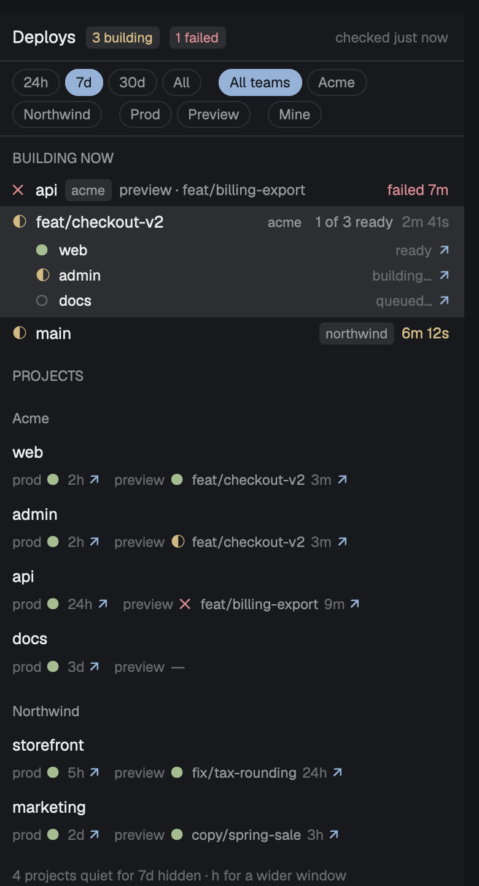

# vercel-panel

A panel for the [Herdr](https://herdr.dev) desktop app that shows your Vercel deploys: what is building right now and how long it's taking, what each project has live in production, and its newest preview. Every site is one click away, a failed build toasts and stays in view, and one key hands the failure to the coding agent working on that branch.



It is a sibling of [pr-panel](https://github.com/donkitchen/herdr-pr-panel) and stacks under it: merge a PR there, watch it build here.

## Requirements

- The [Vercel CLI](https://vercel.com/docs/cli), installed and logged in (`vercel login`). Tested with 65.12.1.
- Nothing else. No npm packages.

The programs it runs are `vercel` (read-only API calls and `vercel inspect --logs`), `sh` (to find your home folder and where `vercel` and `hc` are installed), `security` (only if you keep a token in the macOS Keychain, see below), `hc` (only when you press `a`, to message an agent) and `open` (to open links). It reaches Vercel only, through the CLI and your CLI credentials, and only reads: it never deploys, promotes, rolls back or cancels. It reads and writes two small files in `~/.config/herdr-app/`: its config and its state.

It never runs `vercel switch`, `vercel login` or `vercel link`, and every call names its team, so agents using `vercel` in other terminals keep the team they had. A login with no credentials is never called at all, because the CLI would start a browser login in the background.

## Install

```
git clone https://github.com/donkitchen/herdr-vercel-panel && cd herdr-vercel-panel
scripts/install.sh
```

`install.sh` copies `mods/vercel-panel/` to `~/.config/herdr-app/mods/vercel-panel/` and runs `herdr-app check` on it. Keep the folder name `vercel-panel`. The panel docks on the right by itself and shows every team your Vercel login belongs to, with no config.

Deploys that already finished the first time the panel runs do not toast.

## What it shows

**Building now.** Deploys that are queued or building, one row per push. A push that builds several projects from one commit (a monorepo) is one row, `4 of 6 ready`, with the elapsed time since it started; select it to see each project. The time turns yellow when the build is taking 1.5 times that project's usual build time (the median of its last 10 builds) and red at 3 times. A project with fewer than 3 past builds is never colored. Failed deploys sit here in red until you open their log, ask an agent about them, or a later deploy of the same project and branch succeeds.

**Projects.** One row per project, grouped by team when there are two or more. Each row has production (state, age, link) and the newest preview (branch, state, age, link). The production link opens the project's domain, so it always shows what is live. The preview link opens the branch's own Vercel address, which always serves that branch's newest build, so it never goes stale. Projects with no deploy in the chosen window (7 days to start) are hidden behind a line that counts them.

**Filter chips.** A row under the header narrows what the panel shows, one click each, and remembers your choice across restarts:

- `24h`, `7d`, `30d`, `All`: how far back a project's last deploy can be and still show.
- One chip per team, when your login sees two or more teams. Click one to see only that team, click it again (or `All teams`) for all of them.
- `Prod` or `Preview`: only that kind of deploy. Click again to clear.
- `Mine`: only pushes you made, and projects you've pushed to.

The chips only change the view. Toasts and the top-bar count still cover everything, so a failure in a team you've filtered out still reaches you.

Canceled deploys (the ones a newer push replaced) never appear.

## Toasts

One toast per push, not per project:

- A failure always toasts, for example `feat/x: 2 of 6 failed` with the failed projects named.
- Production going live toasts unless a bot pushed it (a login ending in `[bot]`, or one listed in `bots`).
- A preview toasts only when you pushed it. "You" is the commit author: your Vercel username, your GitHub login, and anything in `me`.
- Muted deploys (see `mute`) never toast, except failures.

Clicking a toast shows the panel with that row selected.

## Keys

In the panel (click it to give it the keyboard):

| Key | Does |
|---|---|
| Up / Down | Move the selection |
| Enter, or click the selected row | Show the build log |
| `v` | Open the site (on a project row: production) |
| `V` | Open the newest preview (project rows) |
| `o` | Open it in the Vercel dashboard |
| `a` | Ask an agent why it failed (failed deploys) |
| `g` | Go to the agent on that branch, else the repo's space |
| `h` | Next time window (24h, 7d, 30d, All) |
| `t` | Next team |
| `p` | Prod only, Preview only, or both |
| `m` | Mine on or off |
| `r` | Refresh now |

The build log opens in a large dialog, scrolled to the first error when the build failed. It scrolls with Up/Down or `j`/`k`, Space and Shift+Space, Page Up/Down, Home and End, and takes `a`, `v`, `o` and Esc.

## Ask an agent

`a` on a failed deploy sends this to the agent working on that branch:

```
The Vercel preview deploy of web (Acme team, branch feat/x, commit 3f2a91c) failed at 12:58. Deploy: https://web-abc123.vercel.app. Build log: `vercel inspect https://web-abc123.vercel.app --logs --scope acme`. Find out why it failed.
```

The agent is found by branch, the same way `g` finds it. If it's busy, the row says `queued for agent` and the message goes in once the agent is idle, never while it's working. The wait lives in memory, so if Herdr restarts, press `a` again. If no agent is on that branch, a new tab opens in the space whose folder is named like the repo, running `claude` (change it with `agent.argv`) with the message as its first task.

## Configure

Optional. Everything lives in `~/.config/herdr-app/vercel-panel.json`, outside the mod folder, so updating the mod never overwrites it. Changes apply without a restart. If the file is not valid JSON, the panel says so in one line and uses defaults. If one setting has a wrong value, that setting keeps its default, the rest still applies, and one line names the problem. Unknown keys are ignored.

| Setting | Default | What it does |
|---|---|---|
| `teams.include` | every team | Only these teams (slug or id) |
| `teams.exclude` | `[]` | Leave these teams out |
| `projects.exclude` | `[]` | Leave these projects out (`project` or `team/project`) |
| `projects.recent_days` | `7` | The starting time window until you click a chip (`0` shows all) |
| `mute` | `[]` | Rules that keep deploys out of "building now" and toasts: `{ "project", "author", "target" }`, every field given must match. Failures are never muted |
| `bots` | `[]` | Extra logins to treat as bots |
| `me` | your Vercel username and GitHub login | Extra logins that count as you |
| `slow.warn` / `slow.late` | `1.5` / `3` | Multiples of the usual build time for yellow and red |
| `refresh_seconds` | 30 while something builds, else 60 | How often it checks Vercel (minimum 15) |
| `accounts` | `[]` | Extra Vercel logins, below |
| `agent.argv` | `["claude"]` | The program a fresh agent runs |

An example ships as [`examples/vercel-panel.json`](examples/vercel-panel.json):

```json
{
  "mute": [{ "project": "scheduled-site", "author": "github-actions[bot]", "target": "production" }],
  "bots": ["acme-bot"],
  "me": ["your-github-login"],
  "projects": { "recent_days": 14 },
  "agent": { "argv": ["claude"] }
}
```

### Teams and more than one login

One Vercel login sees every team it belongs to, and the panel shows all of them. That covers most setups, including a second team for separate billing.

The Vercel CLI holds one login at a time. For a second Vercel account, give it its own config folder and log in there once:

```
vercel login --global-config ~/.config/vercel-work
```

then list it:

```json
{ "accounts": [{ "name": "work", "global_config": "/Users/you/.config/vercel-work" }] }
```

Or keep a token in the macOS Keychain (`security add-generic-password -s vercel-work -a vercel -w <token>`) and use `{ "name": "work", "token_keychain": "vercel-work" }`. The token is read for each refresh and passed only to that call. A team seen by two logins shows once. If one login fails, the others keep working and the message line names it.

If `VERCEL_TOKEN` is set in the environment Herdr started from, the CLI uses that token for the default login.

## Stack it with other panels

On first install the panel docks on the right. To stack it under pr-panel (or anything else) and add a "Deploys" button with a count to the top bar, use a layout. [`examples/layouts/deploy-stack.json`](examples/layouts/deploy-stack.json) is pr-panel's example layout with Deploys added under PRs in the same column and its toggle beside the PRs toggle. Copy it to `~/.config/herdr-app/layouts/` and switch to it, or ask your Herdr agent to add these two blocks to your own layout:

```json
{ "id": "vercel-panel", "type": "block", "size": { "weight": 1 }, "content": { "mod": "vercel-panel" } }
{ "id": "vercel-panel-toggle", "type": "block", "size": { "px": 110 }, "content": { "mod": "vercel-panel", "props": { "role": "toggle" } } }
```

The toggle's count is builds in flight plus failures you haven't opened, and turns red when there is a failure. When every panel in its column is hidden, the empty column hides too, as with pr-panel.

## For later

The code has one place where "a push finished building" happens (`onGroupFinal` in `main.js`). The plan is to tell the agent on that branch, factually and only while it's idle, so an agent that merges a PR hears when the deploy is live or failed. It will be off by default.

## License

MIT
