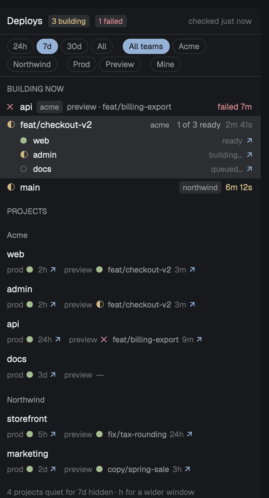

# vercel-panel

A panel on the right side of the Herdr desktop app that shows the person's Vercel deploys. The top section lists builds in flight, one row per push, with elapsed time that turns yellow or red when a build is slow for that project, plus failed builds in red. Below that, every project shows its live production deploy and its newest preview side by side, each a link to the site. A "Deploys" button with a count can sit in the top bar. Enter shows a build log; `a` sends a failed build to the coding agent on that branch.

## What you see

The panel is a mod docked on the right, 360px wide, titled "Deploys", focusable. Colors come only from `theme()`. Top to bottom:

- Header, 38px: `Deploys` at ui font size + 1, semibold; a `{n} building` tag in yellow (ansi3) when builds are in flight, a `{n} failed` tag in red (ansi1) when failures are unopened, a `stale` tag when a team's fetch failed; on the right, dim, `checked just now` or `checked 3m ago`.
- A chip row, wrapping, 6px padding, bottom border: `24h` `7d` `30d` `All`; then, with 2+ teams, `All teams` and one chip per team name; then `Prod` `Preview`; then `Mine`, with a small gap between groups. Chips are 22px pills, accent fill when on, bordered and muted when off. Choices persist in `shared("vercel-panel.filters")` (`{days, team, target, mine}`); with none saved, `days` is `projects.recent_days`.
- A message area only when there is something to say, one yellow line each, cut at 120 characters: a config problem (`vercel-panel.json: ...`), a login problem (`Vercel CLI isn't logged in: run vercel login`), a team that failed (`Acme Co: Can't reach Vercel (offline?)`), or a one-off note from the last key.
- The list, scrollable:
  - `BUILDING NOW`, a small semibold muted header, only when there is a failure or a build in flight. Failed rows first: a red `✕`, project name, a team tag when there are 2+ teams, `preview · branch` muted, a `queued for agent` tag when waiting, and `failed 3m` in red on the right. Then one row per push: a state mark (`◐` building, pulsing opacity 0.35 to 1 over 1400ms; `○` queued), the branch (or project name with no git data), `4 of 6 ready` when the push built several projects, and elapsed time (`3m 12s`) dim, yellow when slow, red when very slow. A selected push, or any push of several projects, lists each project under it with its mark, state word and a `↗` site link.
  - `PROJECTS`, then team headers only with 2+ teams. Each project is two lines: the name, then `prod ● 5d ↗` and `preview ● branch 8h ↗`, with `—` where there is none. `●` is green (ansi2) when ready, red when failed. Links are the accent color and underline on hover.
  - When projects are hidden for being quiet: a dim line `15 projects quiet for 7d hidden · h for a wider window`.
- Empty: centered dim `No deploys yet.` (`Nothing matches these filters.` with a team, target or Mine chip on), or `Checking Vercel…` during the first load.
- Footer hint line, 28px: `⏎ log · v site · o Vercel · a ask agent · h t p m filters · r refresh`.

The toggle (`props: { role: "toggle" }`) is a rounded button reading `Deploys` with a count pill: in-flight builds plus unopened failures. The pill is red (ansi1) when any failure is unopened, accent when only builds are in flight, muted at zero. The button is highlighted while the panel shows.

The peek is a non-modal dialog, 90% of the window: the project name large and semibold with the state word in its color; a line with team, target, `branch · sha7`, pusher, build time and age; then the build log in the terminal font, one 20px row per line, lines with `error`, `failed` or `ERR!` in red and the first such line on a raised background; footer `↑↓ j k scroll · space page · a ask agent · v site · o Vercel · Esc close` (`a` only for failures).

## How it behaves

Config is `~/.config/herdr-app/vercel-panel.json`, read on every refresh. Missing means defaults; not JSON means one line and defaults; a bad value keeps that setting's default and names the first problem; unknown keys are ignored. Defaults: `teams.include` all, `teams.exclude` `[]`, `projects.exclude` `[]`, `projects.recent_days` 7 (0 shows all), `mute` `[]`, `bots` `[]`, `me` `[]`, `slow` 1.5 / 3, `refresh_seconds` 30 while anything builds else 60 (minimum 15), `accounts` `[]`, `agent.argv` `["claude"]`.

Data:
- Logins: the CLI's own, plus each `accounts` entry with `global_config` (a CLI config folder, passed as `-Q`) or `token_keychain` (a Keychain service name, read with `security find-generic-password -s <name> -w` each refresh and passed as `--token`). Before calling `vercel` for a folder login, its `auth.json` must hold a token (`~/Library/Application Support/com.vercel.cli/auth.json` on macOS, `~/.local/share/com.vercel.cli/auth.json` elsewhere, or `<folder>/auth.json`). Without one the CLI would start a device login flow in the background, even with `--non-interactive`.
- At start and every 10 minutes: `/v2/user` (username and GitHub login count as "you"), `/v2/teams`, and `/v9/projects?teamId=` per team. Teams seen by two logins are kept once.
- Every refresh: `/v6/deployments?teamId=<id>&limit=50` per team, all through `vercel api <path> --non-interactive`. Every path carries `teamId`; without it the CLI uses its current team. A team that fails keeps its last list and marks the panel stale.
- Deploy fields: state from `readyState` (QUEUED/INITIALIZING queued, BUILDING, READY, ERROR, CANCELED); target `production` or preview; branch, sha, pusher (`meta.githubCommitAuthorLogin`), repo and `meta.branchAlias` from git metadata. A deploy with no `meta.githubCommitSha` is a CLI deploy: no branch, pusher is `creator.username`. The deploy's `creator` is the same Vercel user for every git deploy, so it never decides who pushed.
- A push is team + repo + branch + sha; CLI deploys stand alone. Canceled deploys are dropped everywhere.
- A project's production link is its first non-`.vercel.app` alias from `targets.production.alias`, else the first alias. A preview link is the newest preview's `branchAlias`, else its own URL.

Toasts, through `notify` with an action that shows the panel, setting a shared select key so the panel selects the row: once per push group when every non-canceled deploy in it is ready or failed. Any failure: `{branch}: {e} of {n} failed` (or `{project} deploy failed` for one), body the failed project names, always. Production ready: `{project} is live` or `{branch}: n of n live`, unless the pusher is a bot (login ends `[bot]` or is in `bots`) or every deploy is muted. Preview ready: `{project} preview ready` or `{branch}: n of n ready`, only when the pusher is "you". The first run records finished deploys and toasts nothing; pushes in flight at first run toast when they finish. Handled deploy ids live in `~/.config/herdr-app/vercel-panel.state.json` (present ids plus the last 500), with the failed ids the person opened.

Chips filter only what is drawn: a team chip keeps that team's failures, pushes and projects; Prod/Preview keeps that target's failures and pushes, and project rows that have that cell (the other cell is left out); Mine keeps deploys whose pusher is "you" and projects with one of them. The header tags, toasts and toggle count ignore the chips.

Failures stay at the top until opened (peek or `a`) or until a later ready deploy of the same project and branch exists.

Panel keys: Up/Down, Enter or click on the selected row (peek), `v` (site; production on a project row), `V` or Shift+`v` (preview on a project row), `o` (the deploy's `inspectorUrl`, or `https://vercel.com/<team>/<project>`), `a`, `g` (focus the pane whose branch matches, else select the space whose folder's last segment is the repo name), `h` (next time chip), `t` (next team), `p` (both, Prod, Preview), `m` (Mine), `r` (refresh, reloading teams and projects). Links open only when http(s).

`a` on a failed deploy builds the message `The Vercel {target} deploy of {project} ({team} team, branch {branch}, commit {sha7}) failed at {HH:MM}. Deploy: {url}. Build log: \`vercel inspect {url} --logs --scope {slug}\`. Find out why it failed.` (only `({team} team)` without git data). A pane with an agent status on that branch (preferring one whose folder is the repo) gets it: focused at once, and the text is sent with `hc send <terminal> <text>` when its status is idle or done, checked every 5 seconds; while working or blocked the row shows `queued for agent`; if the pane goes or stops being an agent, the message is dropped with a note. With no such pane, `tab.new { space, folder, argv, task }` in the repo's space; with no space, a note.

Hiding: as pr-panel, the toggle hides the panel's parent column when every child is hidden and shows it again, never touching Herdr's `panel` column, a column holding a stack, the root, or the tab area.

## Built from

- `mod.json`: `{"place":"right","size":360,"title":"Deploys","focusable":true}`.
- `main.js`: one `View` picking its role from `props.role`: `panel`, `toggle`, `peek`. The peek is `openOverlay({ mod, kind: "dialog", width: 0.9, height: 0.9, props: { role: "peek", deploy, login, vercel, failed } })`. Its `a` hands back through `setShared("vercel-panel.peek-ask", "<id>@<time>")`. The toggle reads `shared("vercel-panel.count")` (`{inFlight, failed}`).
- Pure modules with tests: `config.js`, `vercel.js` (paths, argument builders, parsers, error kinds, log cleaning), `model.js` (groups, failures, project rows, slow levels, links, ages), `seen.js` (toast decisions and the `finals` list of groups that just finished), `agent.js` (message, agent and space lookup, send decision), `collapse.js`.
- Herdr: `exec`, `run` (`pane.focus`, `space.select`, `tab.new`, `layout.toggle/show/hide`), `panes`, `spaces`, `layout`, `notify`, `shared`/`setShared`, `readTextFile`/`writeTextFile`, `openOverlay`/`closeOverlay`, `nextCommand`, `theme`, `settings`, `appHome`. gpui: `v_virtual_list`, `Scrollbar`, `VirtualListScrollHandle`.
- Programs: `vercel`, `sh`, `security`, `hc`, `open`.

## Watch out

- Herdr's `exec` PATH may not include where `vercel` or `hc` are installed (pnpm's `~/Library/pnpm`, `~/.local/bin`). Resolve both once with `command -v`, falling back to `$SHELL -ilc 'command -v <name>'`, and take the last line that is an absolute path (interactive shells print banners).
- `vercel inspect --logs` writes the log to stderr and exits 1 for a failed build. Read both streams; only "no log lines and a non-zero exit" is an error. Strip the `Vercel CLI x.y.z` banner, `<claude-code-hint .../>` lines, ANSI codes and the leading ISO timestamps.
- Never let the CLI run without credentials (see Data). One stray call creates a login.
- Herdr's runtime has no `structuredClone`; clone config with JSON.
- Overlays can't call the panel. Hand things back through shared values and act on a change seen in `render`, scheduling the work on the panel's own task (a task spawned from render's `cx` ends with the frame).
- One push in a monorepo is several deploys; toasting per deploy floods the screen.
- `onGroupFinal` is called with every finished push group and does nothing yet. Telling the agent on that branch is planned there.

## Done when

- `herdr-app check` passes and `npm test` passes.
- With no config, every team on the login appears; project rows show production and newest preview with links that open the right sites.
- A push shows under Building now within one refresh with elapsed time, toasts once when done if you pushed it, and leaves the section.
- A failed build toasts once, shows red at the top, makes the toggle count red, opens its log at the first error line, and `a` reaches the branch's agent (waiting while it works) or opens a new one in the repo's space.
- Canceled deploys never show; a muted bot's production deploys don't toast; projects quiet for 7 days are hidden until a wider time chip; each chip and its key filter the list, survive a restart, and leave the toggle count unchanged.
- `vercel whoami` and the CLI's current team are the same before and after a day of use.
